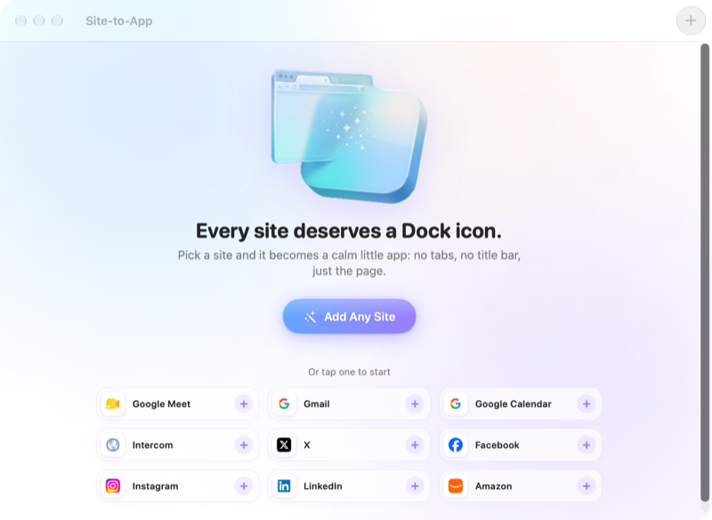

<p align="center"></p>

<h1 align="center">Site-to-App</h1>

<p align="center">Turns any website into a minimal Mac app of its own, with no title bar.</p>

<p align="center"><a href="https://lamp.dev/?repo=https://github.com/lampdotdev/sitetoapp&amp;from=readme"></a></p>

<p align="center"><a href="#build-it-yourself">Build it yourself</a></p>

<p align="center"></p>

## Make Site-to-App yours

Each opens Lamp with a copy of Site-to-App and that change, ready to send:

- [Give it a vintage Mac look](https://lamp.dev/?repo=https://github.com/lampdotdev/sitetoapp&from=readme&ask=Give%20it%20a%20vintage%20Mac%20look)
- [Show two sites side by side](https://lamp.dev/?repo=https://github.com/lampdotdev/sitetoapp&from=readme&ask=Show%20two%20sites%20side%20by%20side)
- [Turn it into a news stand](https://lamp.dev/?repo=https://github.com/lampdotdev/sitetoapp&from=readme&ask=Turn%20it%20into%20a%20news%20stand)

## Open it in Lamp

[Lamp](https://lamp.dev) is a Mac app that builds apps from a description and changes them as you ask. [Open Site-to-App in Lamp](https://lamp.dev/?repo=https://github.com/lampdotdev/sitetoapp&from=readme) for a copy of your own, to use and to change as you like, with the credits below kept. Or, in Lamp, choose File → Open from GitHub… and paste `https://github.com/lampdotdev/sitetoapp`.

## Build it yourself

With Apple's Command Line Tools installed (`xcode-select --install`):

```bash
./build.sh
```

The AI inside the app, and anything it does with other apps or devices, goes through Lamp, so those need Lamp open on the same Mac.

## License

MIT. See [LICENSE](LICENSE).
